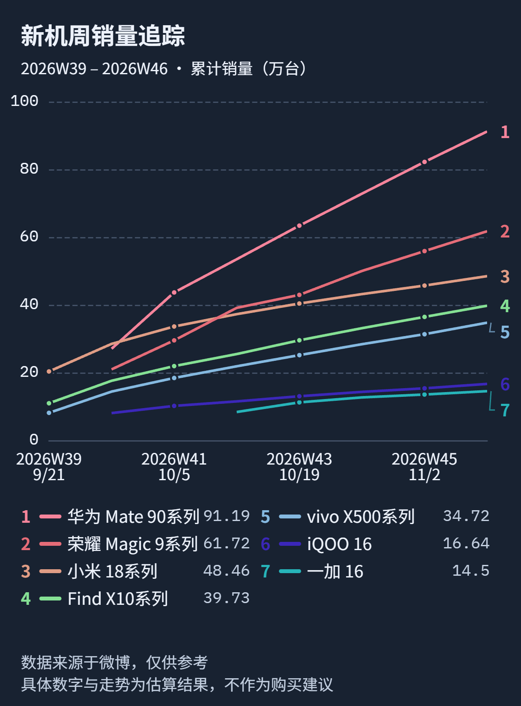
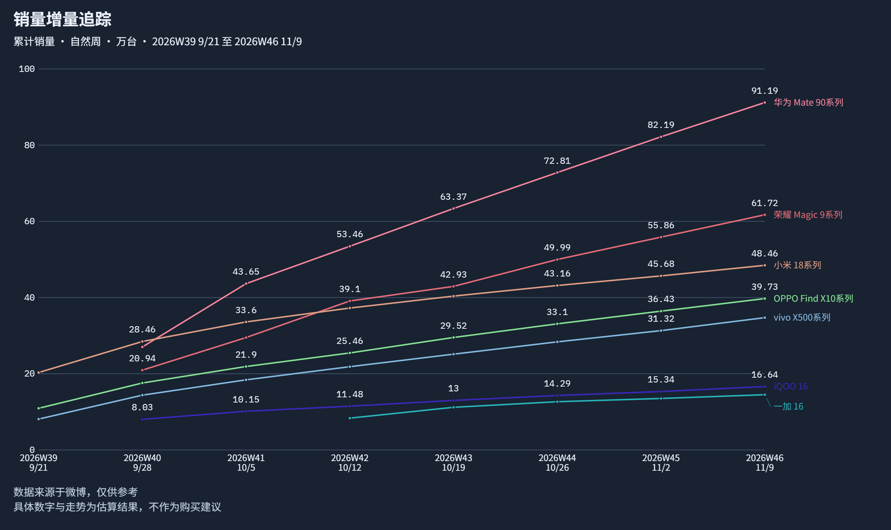

# smartphoneSellOut · Smartphone Sales Visualizations

[简体中文](README.md) · [English](README.en.md)

A smartphone sales dashboard and chart-card toolkit with three independent modules, published on Cloudflare Workers and GitHub Pages. The frontend uses static HTML/CSS/JS and needs no local build.

**[Open the live project](https://smartphonesellout.zirconium.workers.dev/)**

**[GitHub Pages](https://muinocriz.github.io/smartphoneSellOut/)**

<p align="center">
  
</p>
<p align="center">
  
</p>

## Modules

| Module | What it does | Open |
| --- | --- | --- |
| **Sales Increment Tracker** | Track weekly changes from the long-format sales data, compare models by calendar or full sales week, estimate bounded gaps, edit all selected models in one table, and export PNG or CSV. | [Open tracker](https://smartphonesellout.zirconium.workers.dev/sales-increment.html) |
| **Sales Data Editor** | Auto-load project sales and model CSVs; edit cumulative and weekly values, manage special observations and model metadata, check data, save local drafts and export CSVs. | [Sales Data Editor](https://smartphonesellout.zirconium.workers.dev/sales-data-editor.html) |
| **Popular Models and Ranking Research** | Calibrate ranking screenshots against known sales or create posters directly from archived rankings and fourteen research topics; track sales and original ranks together, view rank matrices, merge CSV history and export high-resolution 3:4/9:16 PNGs and ZIP bundles. | [Ranking Estimator](https://smartphonesellout.zirconium.workers.dev/studio/sales-estimator.html) |

The tracker opens by default from the home page. Its top controls import the project CSV, a local CSV, or changes from Sales Data Editor in the same tab. Selecting All Brands shows new models from the latest 12 weeks. Live charts and desktop and mobile PNGs share integer linear and logarithmic ticks.

The two-week brand competition view uses diverging stacked bars for in-list and off-list contributions to share change, with diamonds for the net change in percentage points. The multiweek view connects the same brand across adjacent valid weeks. The TOP30 market coverage study pairs the market-size scenario with a 100% rank-layer composition chart where a feasible interval exists.

## Getting started

Open either live site above, or clone or download the public repository and serve it locally.

```bash
python3 -m http.server 8000
# Open http://localhost:8000
```

Opening `index.html` directly as a local file redirects to the Sales Increment Tracker and may block reading local CSV files; a local web server is recommended.

## Updating data

Both live sites read published data from Cloudflare D1. Local previews read the repository CSVs. Cloudflare admins can publish edits directly, and GitHub Actions can sync changes to the four official CSVs after synchronization is configured.

In Studio, Cloudflare admins can generate, edit and copy a Weibo draft from the current chart card using a plain, analytical or curiosity-led style.

The Legacy Sales Tracking page has been retired; its original wide CSV remains available for Sales Data Editor. Popular Models and Ranking Research optionally combines tracked sales with ranking estimates; Sales Data Editor edits local copies and exports CSVs without writing to the repository. Commit the corresponding CSV to the repository root to publish permanent data updates.

- **Cumulative wide CSV:** Keep `data.csv` in the repository root. Figures are **cumulative sales in units of 10,000 phones**; Sales Data Editor supports manual incremental synchronization. Add a week by appending a column.
- **Whole-market share data (for Popular Models and Ranking Research):** Append one row of shares and market trend per ISO week to `market-share.csv`. From 2026W47, Huawei includes OSTA (separate `OSTA` subbrand column); OPPO includes OnePlus and realme; vivo includes iQOO. Leave undisclosed OSTA shares blank. Do not double-count subbrands. The Cloudflare admin editor also accepts pasted weekly Weibo market-share reports for review and publication.
- **Popular Models and Ranking Research:** Import a ranking screenshot from the left panel, enter model names and the period, and calibrate with known sales for the **same period and definition**. Export the merged full history and commit the downloaded `sales-estimates.csv`. Rankings of different sizes need no zero padding; back up uncommitted data before refreshing. Select an archived ranking to create posters without recalibration. Only final estimates are archived, not the original screenshot or full calibration workspace. The `model-master.csv` catalog (also public for Sales Data Editor) now powers permanent research sequence IDs, alias matching and automatic grouping. Unmatched models retain separate identities; price-band, brand-positioning, chipset, product-age and multidimensional research are available. All fourteen research topics also support direct chart PNG export using the current studio theme, watermark and export width, with adaptive chart geometry and no social safe-area clipping. Topic ZIPs include a PNG, complete analytical CSV, plotted-data CSV, methodology, and a JSON manifest.

- **Sales Data Editor:** Automatically reads `sales-long.csv` and `model-master.csv` unless a local draft is restored. Reload the deployed project long table directly or import a local CSV. Export `sales-long.csv` and `model-master.csv` and commit them manually. The retained wide CSV can be maintained separately. Use the existing project long table as the baseline, select incremental sync from the deployed project wide CSV or a local cumulative wide CSV, review additions and exact-value conflicts, then export and commit the long table. Each applied sync supports undo/redo; the local wide CSV need not be uploaded first. There is no automatic or two-way synchronization.

The Popular Models and Ranking Research defaults to original ranking data; ten of fourteen research topics also support the shared expanded sample: exact weekly observations, reliable cumulative differences, then complete original TOP30 estimates as fallback. Overlapping coverage is deduplicated, combined entries are not split, and expanded mode does not interpolate. Original ranks, ranking persistence and flow, and cross-market studies retain original ranking definitions.


The Popular Models and Ranking Research offers four PNG export resolutions, defaulting to 2160px wide. With safe-area avoidance enabled, the studio can export safe-area and full-layout variants (default right margin 13%, bottom 10%). The Popular Models and Ranking Research presents estimated sales to one decimal place in units of 10,000 phones, retaining CSV precision.

The typography panel at the bottom of the studio sidebar offers per-element font, size, style, and weight controls, live preview, reset, and JSON export. Legends, axis ticks and week labels, and stacked values default to 8 logical units in research chart cards. Multiweek stacked legends are measured and wrapped at the selected size. See the [Maintenance & Design Guide (Chinese)](docs/MAINTAINER_GUIDE.md).

The Popular Models and Ranking Research uses parent-brand color families and distinct point markers, shared across sales and rank charts for the current selection. Sales and original ranks have independent linear and log axis settings, which carry through to exports. The studio supports independent chart headings, notes and footer edits, and returning to the source without resetting the publication.

For the full CSV schema, full-sales-week definitions, poster specifications, design principles, deployment details and implementation notes, see the [Maintenance & Design Guide (Chinese)](docs/MAINTAINER_GUIDE.md).

## Sources and data limitations

Sales-tracking data is manually compiled mainly from public posts by **RD观测** and **数码闲聊站**. It is for reference and personal study, not official reporting. **Tracked sales data contains a selected model sample, not a market-wide ranking; Popular Models and Ranking Research reads the maintained whole-market share CSV (non-official estimates) directly; Popular Models and Ranking Research's original sample describes the corresponding ranking; its expanded sample also includes deduplicated tracked sales. Neither represents the whole market. Sales Data Editor edits do not automatically update published data.** Verify dates, definitions and underlying data before publication.

### Trademarks and disclaimer

This is an independent smartphone sales data compilation, analysis and visualization project. It is not officially affiliated with, authorized or endorsed by the brands or manufacturers mentioned, and does not represent their official positions. Brand names, model names and related trademarks are used solely to identify and distinguish the subjects of analysis. Trademark rights belong to their respective owners.

Figures may contain inaccuracies, gaps or delays due to sample coverage, data collection, estimation methods, reporting periods or subsequent revisions. Sample sales, rankings and shares should not be equated with market-wide sales, rankings or market shares. A model leaving the tracked sample does not mean it has been discontinued or that its actual sales have fallen to zero.

Referencing publicly available data does not imply permission to redistribute third-party data or materials. Any source-code license does not automatically extend to third-party data, trademarks or materials. Verify sources, statistical definitions and applicable permissions before reuse or redistribution. Concerns about data accuracy or legal rights may be reported through [GitHub Issues](https://github.com/muinocriz/smartphoneSellOut/issues) (do not post sensitive information publicly) for review and appropriate action by the maintainers.

## Deployment

Cloudflare Workers and GitHub Pages run independent deployments from `master` using the same build manifest. GitHub Pages retains a D1 snapshot in its build and reads the public API at runtime. Popular Models and Ranking Research uses the site-relative path `studio/sales-estimator.html`. See the [deployment guide (Chinese)](docs/CLOUDFLARE_DEPLOYMENT.md).

## Documentation

- [CHANGELOG.md](CHANGELOG.md) — feature history and fixes.
- [Maintenance & Design Guide (Chinese)](docs/MAINTAINER_GUIDE.md) — data schema, visual rules and technical maintenance.
- [Popular Models and Ranking Research Architecture (Chinese)](docs/MODULE3_ARCHITECTURE.md) — research engine, preferences, initialization isolation and generated datasets.

**Acknowledgement:** Thanks to [@zhoulin12138](https://github.com/zhoulin12138) for ideas, guidance and support.


