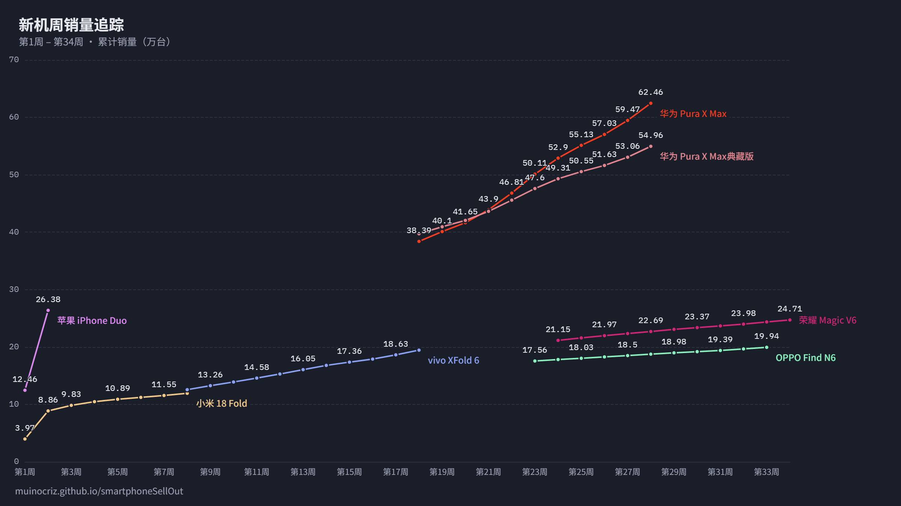

# smartphoneSellOut · 手机销量数据可视化

[简体中文](README.md) · [English](README.en.md)

一个部署于 Cloudflare Workers 的手机销量分析与图文制作项目，包含销量追踪、市场份额和榜单推算三个独立模块。业务前端保持原生静态 HTML/CSS/JS，本地预览无需构建；线上部署通过 Worker 实施访问控制。

**[在线打开项目](https://smartphonesellout.zirconium.workers.dev/)**

<p align="center">
  
</p>

## 功能与入口

| 模块 | 用途 | 进入 |
| --- | --- | --- |
| **01 · 销量追踪** | 查看累计销量、周增量及完整销售周趋势；默认选择近12周新机，支持机型筛选、自建列表、跨期里程碑及桌面／手机 PNG 导出。 | [打开销量追踪](https://smartphonesellout.zirconium.workers.dev/) |
| **02 · 市场份额** | 自动读取 `market-share.csv`，选择连续两周品牌份额，支持本地 CSV 导入与手动编辑；五种图表（含规模比例堆叠图）、六套主题和 3:4 高清 PNG 导出。 | [打开市场份额](https://smartphonesellout.zirconium.workers.dev/#market-share) |
| **03 · 榜单推算与出图** | 导入截图并标定估算入榜销量，或直接选择历史榜单及十四个研究专题制作图卡；支持销量与原始排名联动追踪、排名矩阵、CSV 存档、3:4／9:16 高清 PNG 和 ZIP 导出。 | [打开榜单推算](https://smartphonesellout.zirconium.workers.dev/#sales-estimator) |

## 快速使用

访问上方在线入口即可使用；模块 1／2 公开，模块 3 需要授权。拥有私有仓库访问权限的维护者可克隆或下载仓库，在项目根目录执行：

```bash
python3 -m http.server 8000
# 浏览器访问 http://localhost:8000
```

直接双击 `index.html` 可能受到浏览器本地文件读取限制；推荐使用本地服务器。

## 数据更新

三个模块各自使用独立的 CSV，统计口径不同，不混用。更新正式数据时，将相应 CSV 提交至仓库根目录。

- **模块 1**：编辑根目录 `data.csv`，新增一周只需追加周列；CSV 存储的是**累计销量**（单位：万台），周销量由相邻周差分计算。
- **模块 2**：编辑 `market-share.csv`，每个 ISO 周追加一行份额与大盘趋势；OPPO 集团已包含一加与 realme，vivo 集团已包含 iQOO，不重复相加。页面自动读取，也支持本地导入、历史周选择与手动修改。
- **模块 3**：在左侧导入榜单截图，补全机型名称、统计周期及同口径标定销量；点击“合并本期并导出完整历史 CSV”，提交下载的 `sales-estimates.csv`。不同榜单规模无需补零；刷新前备份未提交数据。历史榜单可直接选择出图，无需再次标定。仅存档正式估算结果，不保存原图或完整标定工作区。 受保护的 `model-master.csv` 已接入研究身份关联与自动分组；机型别名复用永久 ID，未匹配保留独立标识，已新增价格带、品牌定位、芯片平台、新老产品结构及多维竞争研究。专题发布包包含 PNG、文案、标题与轮播、完整统计 CSV、图表显示数据 CSV、统计口径及 JSON 发布清单。

模块 2／3 出图均支持四档 PNG 分辨率，默认宽度 2160px；开启抖音安全区后可多版本导出规避版和完整版，默认右侧 13%、底部 10%；模块 3 展示估算销量以万台保留一位小数，CSV 保留原有精度。

模块 3 跨模块研究还提供「榜内与全市场品牌竞争分析」：保留双周流向或多周堆叠流向，并新增六大母品牌3行×2列增长贡献图（深色柱为榜内环比、浅色柱为榜外环比、折线为品牌总销量环比）；原有流向图上下分别使用完整原始TOP30与模块2全市场份额，六大母品牌同色同序、保持原始分母，不把未绘制的其他品牌重新归一化。双周模式可自选基准周与对比周，只有右侧变化(pp)列以淡红/淡绿背景突出本图最大上涨/下跌（并列同时高亮）；多周模式随上方统计区间展示每周堆叠柱，在相邻有效周间用半透明色带连接同一品牌，不显示变化(pp)，缺失周断开连接。榜单生态研究的「品牌结构与集中度 → 多周堆叠柱状图」也采用同样的相邻同品牌半透明色带，保留原有销量占比／上榜数量占比／绝对销量口径；这些色带不代表用户或销量从品牌间转移。两项研究都沿用CSV、图卡和ZIP导出流程。全部14项研究专题另提供统一的直接图表PNG导出（当前主题、水印及宽度，自适应图表尺寸，无安全区裁切）。

模块 3 的时间序列堆叠图已统一使用共享的相邻类别色带绘制逻辑：除榜单生态研究的品牌多周堆叠外，产品属性与竞争研究中的「价格带历史堆叠」「芯片供应商／平台历史结构堆叠」和生命周期研究中的「上市年龄结构堆叠」均在相邻有效周之间绘制淡色连接带；数据、分类、色彩和分母沿用各专题，未知类别仍计入，缺失周断连。跨模块多周双图也调用同一色带绘制器；末周价格带×品牌等非自然周分类柱图不加入周间色带。

模块 3 跨模块研究「TOP30市场覆盖率与销量分层」固定使用完整原始排名1—30名、TOP30中苹果销量和模块2同周苹果市场份额，自动推导市场总销量的必要下界。两个约束可独立启用：①「榜外苹果机型数量上限」（默认2款）把每周CSV第30名的真实销量作为榜外每款销量上限，计算市场规模上界并用浅色带绘制可行区间；中心线仅取区间算术中点，不代表统计点估计。②「模块2量化环比趋势检查」（默认容差±5个百分点）对相邻自然周的市场规模可行区间作一致性检查，连续3个有效对比周有区间冲突才提示连续异常；未启用SKU时仅可比较苹果锚点下界的条件性环比参考，不将其判为真实市场异常。苹果入榜率由各周市场规模上下界自动推导，不再独立输入95%或85%。关闭SKU约束时只有市场下界，不能伪造上界或中心；不完整榜单或缺少同周市场份额保留缺失。默认上下双图，上图为市场规模与情景带，下图为TOP3、TOP4–10、TOP11–30、榜外的100%堆叠结构；没有可行区间不绘制下图。专题继续保留TOP30覆盖率区间、环比指数和偏差视图，表格、CSV、图卡、ZIP输出推导数据和检查状态。假设性界限与统计置信区间不同，异常提示不自动修正销量。

模块 3 机型追踪保留母品牌色系，以不同点形区分同品牌机型；同一选择下销量和排名标记一致。排名始终取原始榜单，不插补、不重新排名。工作台可独立编辑图表主副标题、附注及页脚，并返回来源保留发布状态。

CSV 字段、完整销售周口径、设计约定、部署和维护方法见 [维护与设计指南](docs/MAINTAINER_GUIDE.md)。

## 数据来源与使用说明

销量追踪数据主要根据 **RD观测**、**数码闲聊站** 等公开内容人工整理，仅供学习与参考，不代表官方统计。**模块 1 是选定机型样本，不是全市场销量总榜；模块 2 默认加载仓库中的可编辑份额 CSV（非官方实时统计），读取失败时提示导入本地 CSV，不再内置示例份额；模块 3 的估算仅适用于对应统计期的入榜样本，不代表品牌全市场份额。** 发布前请自行核实统计周期、品牌口径及原始数据。

## Cloudflare 分模块部署

生产站点已迁移至 Cloudflare Workers；GitHub 源仓库为 Private，原 GitHub Pages 已由维护者关闭。模块 1／2 公开（含 `data.csv` 和 `market-share.csv`），模块 3 须使用获准邮箱通过 Cloudflare Access 一次性验证码认证；其页面、历史 CSV 和衍生数据位于 `/studio/`，由 Worker 服务端校验 Access JWT。模块 2 的公开资源在根目录提供，构建保留 `/studio/market-share.csv` 等兼容副本供跨模块研究使用。部署仅发布白名单资产，私有仓库的 `master` 分支继续作为部署来源。本地开发入口不应用访问控制。验收范围和维护事项详见[部署指南](docs/CLOUDFLARE_DEPLOYMENT.md)。

## 更多文档

- [CHANGELOG.md](CHANGELOG.md)：功能更新与问题修复记录。
- [维护与设计指南](docs/MAINTAINER_GUIDE.md)：数据格式、图卡规格、设计原则和开发维护说明。
- [公开图卡文案规范](docs/PUBLIC_POSTER_COPY_GUIDE.md)：四类基础图卡与14个研究专题的标题、副标题、标签、图内提示和底部说明。
- [模块3架构与派生数据](docs/MODULE3_ARCHITECTURE.md)：研究数据引擎、版本化配置、初始化隔离与生成物。

**致谢**：感谢 [@zhoulin12138](https://github.com/zhoulin12138) 提供的思路、辅导与支持。

模块1缺失周默认保留原始观测；可选线性或历史趋势约束估算（只在两个真实累计端点之间，最近连续真实增量拟合，累计守恒）。本周与跨期里程碑按真实观测区分，估算不写回 CSV。

模块1约定：累计正数恰为50万台整数倍即为虚拟里程碑下限（≥），与间隔无关；不参与真实周增量或趋势样本，可在估算模式下作为任一端点（不是精确值），包括连续两个里程碑之间；含虚拟左端点的差额仅为参考。
